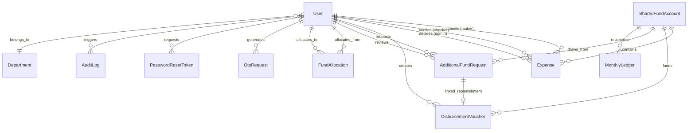
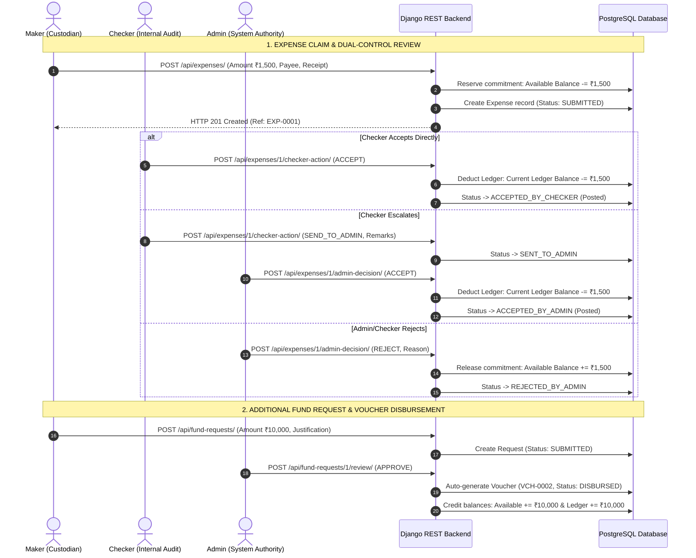

# Petty Expenses Management System — Comprehensive Architecture & Feature Overview

---

## 1. Executive Summary & System Purpose

The **Petty Expenses Management System** is an enterprise-grade, web-based financial control application engineered in strict compliance with the **Software Requirements Specification (SRS v1.3)**. It enforces a strict **3-Role Governance Model** (**Admin**, **Maker**, and **Checker**), eliminating single-point financial discretion, establishing strict dual-control over petty cash disbursements, and maintaining an immutable audit trail of every operational transaction.

### Core System Principles
1. **Zero Approval Threshold (BR-04)**: The approval threshold is strictly set to **₹0**. Every single expense claim—regardless of how minor—must undergo formal review through the internal audit verification queue (Checker) and receive final executive disposition (Admin).
2. **Whole Number Financial Arithmetic (BR-01, BR-07)**: All monetary values in the application are strictly modeled and handled as whole-number Indian Rupees (`BigIntegerField` in PostgreSQL / fixed integers in JavaScript). Fractional values (paise) are disallowed across both database and user interfaces to prevent rounding discrepancies.
3. **Dual-Balance Financial Accounting**: Every fund account maintains a real-time segregation between actual posted funds (`current_ledger_balance`) and spendable float (`available_balance`), mediated by active `outstanding_commitments`.
4. **Voucher-Governed Disbursements (BR-01, BR-02)**: No funds can enter the system or replenish balances without an explicit disbursement voucher (`VCH-xxxx`) accompanied by recorded banking/cash payment references.
5. **Full Carry-Forward & Period Reconciliation (BR-09, BR-10)**: Unspent closing balances at month-end automatically carry forward 100% into the opening balance of the succeeding month without forfeiture or balance resets.

---

## 2. Technology Stack & Architectural Overview

The application is structured as a decoupled client-server architecture consisting of a Python/Django REST API backend and a React/Vite single-page application (SPA) frontend.

```
+------------------------------------------------------------------------------------+
|                                FRONTEND LAYER                                      |
|  React 18 + Vite SPA | React Router v6 | Lucide Icons | Context API (Auth, Confirm) |
+------------------------------------------------------------------------------------+
                                      |
                             REST API (JSON / JWT)
                                      |
+------------------------------------------------------------------------------------+
|                                 BACKEND LAYER                                      |
|  Django 5.x REST Framework | Custom JWT Authentication | Role-Based Access Control |
+------------------------------------------------------------------------------------+
                                      |
                               Database ORM
                                      |
+------------------------------------------------------------------------------------+
|                                DATA PERSISTENCE                                    |
|       PostgreSQL Relational DB | Multipart Media Storage (Receipts & Avatars)       |
+------------------------------------------------------------------------------------+
```

### Technology Matrix
- **Backend Framework**: Django 5.x & Django REST Framework (DRF)
- **Primary Database**: PostgreSQL (`petty_expenses`)
- **Authentication**: Custom stateless JSON Web Token (JWT) system with `token_version` revocation
- **Frontend Framework**: React 18 with Vite bundling
- **Routing & State**: React Router DOM v6, React Context API (`AuthContext`, `ConfirmContext`)
- **UI Components & Icons**: Modern clean styling (`index.css`), Lucide React icon library
- **Document Generation & Reporting**: ReportLab PDF generation engine (`generate_pdf.py`), client-side CSV tabular exporter
- **Testing & Quality Assurance**: Playwright async end-to-end browser test suites (`frontend/e2e/`), Django test runners, custom workflow validation harnesses (`verify_workflow.py`)

---

## 3. Segregation of Duties (SoD) & Role Matrix

The system enforces a strict boundary between the three distinct organizational personas:

```
               +------------------------------------------------+
               |                  ADMIN ROLE                    |
               |  - Master system authority                     |
               |  - User lifecycle (Create, Edit, Toggle, Del)  |
               |  - Fund allocations & Voucher disbursements     |
               |  - Additional fund request review              |
               |  - Final decision on claims (Accept / Reject)  |
               |  - Department masters & Audit log inspection   |
               +-----------------------+------------------------+
                                       |
                   Disburses Funds /   |   Final Decision
                   Oversees Accounts   |   on Escalated Claims
                                       v
        +------------------------------+------------------------------+
        |                                                             |
        v                                                             v
+-------------------------------+             +-------------------------------+
|          MAKER ROLE           |             |         CHECKER ROLE          |
|  - Petty cash custodian       |             |  - Internal audit reviewer    |
|  - Prepares & submits claims  |  Submits    |  - Verifies maker claims      |
|  - Enters payee, amount, bill | ----------> |  - Exactly 2 actions:         |
|  - Reserves commitment float  |   Expense   |    1. Accept (Post/Verify)    |
|  - Requests additional funds  |             |    2. Send to Admin (Escalate)|
|  - Cancels submitted claims   |             |  - Sub-allocates float to MKR |
+-------------------------------+             +-------------------------------+
```

| Dimension | Admin (`ADMIN`) | Maker (`MAKER`) | Checker (`CHECKER`) |
| :--- | :--- | :--- | :--- |
| **System Origin** | 1st Admin seeded via database / SQL script | Created by Admin | Created by Admin |
| **Primary Responsibility** | Governance, disbursements, and final decisions | Petty cash custodial spending | Independent verification and internal audit |
| **User Management** | Creates, edits, deactivates, deletes Makers & Checkers (self-deletion blocked; cannot edit/delete other Admins) | No user management access | Can view Makers, create new Maker accounts, edit Maker profiles, allocate funds to Makers |
| **Fund Allocation** | Issues Initial & Supplementary Vouchers (`VCH-xxxx`), disburses money to accounts | Requests supplementary funds via formal justification | Can sub-allocate from own available float down to assigned Makers |
| **Expense Submission** | Does not submit expenses directly | Submits claims with mandatory receipts, payee, whole INR amount | Can submit direct claims (which route straight to Admin for decision) |
| **Claim Review Authority** | Final executive decision on escalated claims: **Accept** (posts to ledger) or **Reject** (returns float) | No review permissions; can cancel own claims if still in `SUBMITTED` state | **Accept** (verifies receipt & posts) or **Send to Admin** (escalates with mandatory comment) |
| **Threshold Limits** | ₹0 (must review all escalated claims) | Cannot exceed spendable balance limit | ₹0 (must verify all claims) |
| **Financial Ledger Control** | Monthly closing, reconciliation, period locking | View personal ledger & claims | View assigned accounts & audit queue |

---

## 4. Financial Balance Mechanics & Accounting Formulas

### Dual-Balance Architecture (BR-03, BR-07)
A shared fund account (`SharedFundAccount`) links a Maker-Checker custodial pair to prevent phantom balances or unverified spending. Balance changes follow exact mathematical rules:

```
+------------------------------------------------------------------------------------+
|                         CURRENT LEDGER BALANCE (CLB)                               |
|                (Actual financial cash on hand in the custodian float)              |
+------------------------------------------------------------------------------------+
                                      |
                 Minus Outstanding Commitments (Reserved Float)
                                      |
                                      v
+------------------------------------------------------------------------------------+
|                          AVAILABLE BALANCE (AVB)                                   |
|               (Maximum spendable float available for new claims)                   |
+------------------------------------------------------------------------------------+
```

### Core Mathematical Equations

1. **Available Balance Formula**:
   $$\text{Available Balance} = \text{Current Ledger Balance} - \text{Outstanding Commitments}$$

2. **Claim Submission Transition (Commitment Reservation)**:
   When Maker submits an expense claim of amount $X$:
   $$\text{Available Balance}_{\text{new}} = \text{Available Balance}_{\text{old}} - X$$
   $$\text{Outstanding Commitments}_{\text{new}} = \text{Outstanding Commitments}_{\text{old}} + X$$
   *(Current Ledger Balance remains unaffected at submission time).*

3. **Approval Transition (Commitment Realization)**:
   When Checker or Admin accepts an expense claim of amount $X$:
   $$\text{Current Ledger Balance}_{\text{new}} = \text{Current Ledger Balance}_{\text{old}} - X$$
   $$\text{Outstanding Commitments}_{\text{new}} = \text{Outstanding Commitments}_{\text{old}} - X$$
   *(Available Balance does not change because the funds were already reserved).*

4. **Rejection or Cancellation Transition (Commitment Release)**:
   When Admin/Checker rejects the claim, or Maker cancels a `SUBMITTED` claim:
   $$\text{Available Balance}_{\text{new}} = \text{Available Balance}_{\text{old}} + X$$
   $$\text{Outstanding Commitments}_{\text{new}} = \text{Outstanding Commitments}_{\text{old}} - X$$
   *(The reserved amount returns immediately to the spendable float).*

5. **Disbursement Voucher Posting (Float Replenishment)**:
   When Admin issues and disburses a voucher (`VCH-xxxx`) of amount $V$:
   $$\text{Current Ledger Balance}_{\text{new}} = \text{Current Ledger Balance}_{\text{old}} + V$$
   $$\text{Available Balance}_{\text{new}} = \text{Available Balance}_{\text{old}} + V$$

6. **Monthly Ledger Closing Formula (BR-09, BR-10)**:
   $$\text{Closing Balance} = \text{Opening Balance} + \sum \text{Disbursements} - \sum \text{Approved Expenditures}$$
   The calculated `Closing Balance` becomes the `Opening Balance` of the subsequent calendar month without forfeiture.

---

## 5. Comprehensive Database Entity-Relationship Model

The PostgreSQL database enforces relational integrity, referential constraints, and unique code numbering through custom model generators.



### Database Tables & Field Definitions

#### 1. `users` (`accounts.User`)
*Custom user model extending `AbstractBaseUser` and `PermissionsMixin`.*
- `id` (PK, BigInt): Primary auto-increment identifier.
- `employee_id` (CharField, Unique): Auto-generated unique employee code (`ADM0001`, `MKR0002`, `CHK0003`).
- `email` (EmailField, Unique): Primary authentication identifier.
- `full_name` (CharField): User's legal/display name.
- `role` (CharField): Enums `ADMIN`, `MAKER`, `CHECKER`.
- `department` (CharField): Assigned organizational department name.
- `designation` (CharField): Corporate job title.
- `phone` (CharField): Contact phone number.
- `photo` (FileField): Upload path `profiles/%Y/%m/` for profile photo.
- `allocated_funds` (BigIntegerField): Direct individual funding limit in whole INR.
- `token_version` (IntegerField): Integer incremented on password changes to invalidate all active JWTs.
- `must_change_password` (BooleanField): Forces the change password modal on next login if `True`.
- `is_active` (BooleanField): Soft-deletion / deactivation toggle.
- `last_refresh_at` (DateTimeField): Audit timestamp of last user synchronization.

#### 2. `shared_fund_accounts` (`expenses.SharedFundAccount`)
*Represents the shared monetary pool assigned to a Maker-Checker pair.*
- `id` (PK, BigInt): Auto-increment primary key.
- `account_id` (CharField, Unique): Business code (`FA-0001`, `FA-0002`).
- `name` (CharField): Name of the fund pool (e.g., "Operations Petty Cash").
- `maker` (FK -> `User`): Assigned primary Maker.
- `checker` (FK -> `User`): Assigned internal audit Checker.
- `admin` (FK -> `User`): Overseeing Admin authority.
- `opening_balance` (BigIntegerField): Starting balance for the calendar month in whole INR.
- `current_ledger_balance` (BigIntegerField): Realized posted ledger balance.
- `available_balance` (BigIntegerField): Spendable float after subtracting commitments.
- `is_active` (BooleanField): Fund account status toggle.

#### 3. `expenses` (`expenses.Expense`)
*The central operational record tracking every petty expenditure.*
- `id` (PK, BigInt): Auto-increment primary key.
- `reference_number` (CharField, Unique): Auto-generated reference code (`EXP-0001`, `EXP-0002`).
- `fund_account` (FK -> `SharedFundAccount`): Linked fund account.
- `maker` (FK -> `User`): Custodian who submitted the claim.
- `expense_date` (DateField): Incurred date (restricted to $\le$ current date).
- `amount` (BigIntegerField): Expense claim amount in whole INR.
- `category` (CharField): Classification (e.g., Office Supplies, Food, Travel).
- `payee` (CharField): Payee, vendor, or store name.
- `description` (TextField): Mandatory explanation of the expenditure.
- `supporting_document` (FileField): Uploaded tax receipt/invoice (up to 50MB).
- `status` (CharField): Operational lifecycle state:
  - `SUBMITTED`: Awaiting Checker review.
  - `ACCEPTED_BY_CHECKER`: Verified by Checker and posted.
  - `REJECTED_BY_CHECKER`: Denied by Checker; commitment returned to float.
  - `SENT_TO_ADMIN`: Escalated to Admin for final disposition.
  - `ACCEPTED_BY_ADMIN`: Accepted by Admin and posted to ledger.
  - `REJECTED_BY_ADMIN`: Denied by Admin; commitment returned to float.
  - `CANCELLED`: Cancelled by the submitting Maker before review.
- `checker` (FK -> `User`): Checker who audited the claim.
- `checker_action` (CharField): `NONE`, `ACCEPT`, `REJECT`, `SEND_TO_ADMIN`.
- `checker_comments` (TextField): Mandatory remarks on rejection or escalation.
- `checker_timestamp` (DateTimeField): Verification timestamp.
- `admin` (FK -> `User`): Admin who resolved the claim.
- `admin_decision` (CharField): `NONE`, `ACCEPT`, `REJECT`.
- `admin_comments` (TextField): Mandatory remarks on Admin rejection.
- `admin_timestamp` (DateTimeField): Executive decision timestamp.
- `posted_at` (DateTimeField): Date-time when expenditure posted to ledger.

#### 4. `disbursement_vouchers` (`expenses.DisbursementVoucher`)
*Official disbursement instruments for initializing or replenishing cash pools.*
- `id` (PK, BigInt): Primary key.
- `voucher_number` (CharField, Unique): Format `VCH-0001`.
- `fund_account` (FK -> `SharedFundAccount`): Target account.
- `voucher_type` (CharField): `INITIAL` or `SUPPLEMENTARY`.
- `beneficiary` (CharField): Recipient name.
- `amount` (BigIntegerField): Disbursed whole INR amount.
- `purpose` (TextField): Official disbursement justification.
- `payment_mode` (CharField): `CASH`, `BANK_TRANSFER`, `CHEQUE`, `UPI`, `OTHER`.
- `payment_reference` (CharField): Bank UTR, cheque number, or transaction hash.
- `payment_date` (DateField): Disbursement date.
- `status` (CharField): `DRAFT`, `APPROVED`, `DISBURSED`, `CANCELLED`.
- `linked_request` (FK -> `AdditionalFundRequest`, Nullable): Originating request if supplementary.

#### 5. `additional_fund_requests` (`expenses.AdditionalFundRequest`)
*Formal requests from custodians when available float is exhausted.*
- `id` (PK, BigInt): Primary key.
- `request_number` (CharField, Unique): Auto-generated request number (e.g. `10001`).
- `fund_account` (FK -> `SharedFundAccount`): Target fund account.
- `maker` (FK -> `User`): Requesting custodian.
- `requested_amount` (BigIntegerField): Requested whole INR amount.
- `approved_amount` (BigIntegerField, Nullable): Final amount approved by Admin.
- `reason` (TextField): Mandatory justification statement.
- `supporting_document` (FileField, Nullable): Optional quote or proforma invoice.
- `status` (CharField): `SUBMITTED`, `SENT_TO_ADMIN`, `APPROVED`, `PARTIALLY_APPROVED`, `REJECTED`, `DISBURSED`, `CANCELLED`.
- `reviewed_by` (FK -> `User`): Admin who adjudicated the request.
- `review_comments` (TextField): Administrative feedback.

#### 6. `fund_allocations` (`expenses.FundAllocation`)
*Audit log of direct peer-to-peer or admin-to-user float assignments.*
- `allocation_number` (CharField, Unique): Format `ALC-10001`.
- `allocated_by` (FK -> `User`): Allocating user (Admin or Checker).
- `allocated_to` (FK -> `User`): Recipient user (Maker or Checker).
- `amount` (BigIntegerField): Whole INR allocation.
- `allocator_role` / `recipient_role` (CharField): Role snapshots.
- `allocator_previous_balance` / `allocator_new_balance` (BigIntegerField): Float snapshots of allocator.
- `recipient_previous_balance` / `recipient_new_balance` (BigIntegerField): Float snapshots of recipient.
- `voucher_number` / `payment_type` / `allocation_date` / `notes`: Metadata trail.

#### 7. `monthly_ledgers` (`expenses.MonthlyLedger`)
*Formal monthly period reconciliation and locking records.*
- `fund_account` (FK -> `SharedFundAccount`): Target account.
- `year` (IntegerField) & `month` (IntegerField): Unique calendar period (`unique_together`).
- `opening_balance` (BigIntegerField): Starting balance.
- `total_disbursements` (BigIntegerField): Sum of completed vouchers in period.
- `total_approved_expenditure` (BigIntegerField): Sum of posted expenses in period.
- `closing_balance` (BigIntegerField): Calculated carry-forward balance.
- `is_locked` (BooleanField): Locks period against subsequent back-dated changes.
- `closed_by` (FK -> `User`) & `closed_at` (DateTimeField): Period closure audit metadata.

#### 8. `departments` (`accounts.Department`)
*Master table for organizational units.*
- `name` (CharField, Unique): Department title (e.g., "Engineering", "Marketing").
- `code` (CharField, Unique): Derived uppercase abbreviation (e.g., `ENGI`, `MARK`).
- `description` (TextField): Department scope.
- `is_active` (BooleanField): Department status.

#### 9. `audit_logs` (`expenses.AuditLog`)
*Immutable security and governance journal.*
- `user` (FK -> `User`, Nullable): Acting user (or System).
- `action` (CharField): Action identifier (`USER_LOGIN`, `EXPENSE_CLAIMED`, `CHECKER_ACCEPT`, etc.).
- `record_type` (CharField): Target entity (`USER`, `EXPENSE`, `VOUCHER`, `MONTHLY_LEDGER`).
- `record_id` (CharField): ID or reference number of modified entity.
- `details` (TextField): Narrative description of change.
- `ip_address` (CharField): Client IP address resolved from HTTP request headers.
- `created_at` (DateTimeField): Precise server timestamp.

#### 10. `otp_requests` & `password_reset_tokens`
*Security credential verification models.*
- `OtpRequest`: 6-digit numeric OTP, 5-minute expiry, max 5 attempts. Used for secure in-portal password updates.
- `PasswordResetToken`: Cryptographic 64-character token with 30-minute expiry for unauthenticated forgot-password resets.

---

## 6. Detailed Feature Interconnection & End-to-End Workflows

Every feature in the system is tightly interconnected with backend API endpoints, validation logic, state changes, and automated audit logging.



### Feature 1: Authentication, Session Management & Password Security
- **Email + Password Login (`POST /api/auth/login/`)**:
  - No OTP required on login for streamlined daily custodian access.
  - Supports "Remember Me" toggle: session duration is **7 days** if checked, **1 day (24 hours)** if unchecked.
  - Issues paired JWTs (access token + refresh token) signed with `JWT_SECRET_KEY` (HS256 algorithm).
  - Automatically records client IP address (parsing `X-Forwarded-For` or `REMOTE_ADDR`) in `AuditLog`.
- **Automatic JWT Refresh Interceptor (`api.js` & `POST /api/auth/refresh/`)**:
  - Axios response interceptor intercepts HTTP 401 Unauthorized responses.
  - Transparently requests a new access token using the valid refresh token without interrupting the user's workflow.
  - Automatically redirects to `/login` if refresh token is expired or revoked.
- **In-Portal Change Password with 6-Digit Email OTP (`/api/auth/password/otp/request/` & `/change/`)**:
  - Users changing their own password must request a 6-digit OTP code sent to their registered email (simulated in console in development).
  - OTP expires strictly after 5 minutes and is invalidated after 5 failed attempts.
  - Password must satisfy high complexity requirements: $\ge 8$ chars, uppercase, lowercase, digit, and special symbol.
  - Successful password change increments `token_version`, immediately invalidating all other existing JWT sessions.
- **Forgot Password Reset Flow (`/api/auth/forgot-password/` & `/reset-password/confirm/`)**:
  - Generates a unique 64-character token with a 30-minute validity window.
  - Reset page features a live countdown timer and validates password matching before committing.

### Feature 2: Expense Claim Preparation, Submission & Validation
- **Submit Expense Modal (`SubmitExpenseModal.jsx`)**:
  - Available to Makers and Checkers via global navigation and dashboard action buttons.
  - **Date Validation**: Future calendar dates are blocked via HTML `max` attribute and JavaScript assertions.
  - **Numeric Precision**: Decimal inputs and mousewheel scrolling on number inputs are disabled to prevent accidental amount modifications.
  - **Mandatory Bill Attachment**: Requires a valid supporting document (PNG, JPG, PDF) with a 50MB ceiling (`DATA_UPLOAD_MAX_MEMORY_SIZE = 52428800`).
  - **Saved Vendors Integration (`SavedVendorListView`)**: Autocompletes payees from previously saved vendors and offers a "Save Vendor Name" checkbox.
  - **Database Commit & Float Encumbrance**: Atomically reserves the requested amount from the fund account's available balance (`available_balance -= amount`) within a database transaction block (`transaction.atomic()`).

### Feature 3: Independent Checker Audit & Verification Queue
- **Verification Queue (`CheckerDashboard.jsx` & `CheckerActionView`)**:
  - Displays all claims submitted by Makers with real-time status badges and view details actions.
  - Checker has exactly three possible actions:
    1. **ACCEPT**: Confirms verification of tax invoices and physical stock; immediately posts expenditure to the financial ledger (`current_ledger_balance -= amount`), setting status to `ACCEPTED_BY_CHECKER`.
    2. **REJECT**: Requires mandatory explanation; restores reserved commitment back to available float (`available_balance += amount`), setting status to `REJECTED_BY_CHECKER`.
    3. **SEND_TO_ADMIN**: Escalates claim to Admin with mandatory remarks for discretionary review, setting status to `SENT_TO_ADMIN`.
- **Claim Details Inspection Modal**:
  - Live document preview supporting zoom, rotate, fullscreen, and inline PDF iframe embedding (`X-Frame-Options: SAMEORIGIN`).
  - Shows complete chronological approval workflow trail including timestamps and notes.

### Feature 4: Admin Executive Governance & Final Disposition
- **Admin Decision Queue (`AdminDashboard.jsx` & `AdminDecisionView`)**:
  - Displays claims escalated by Checkers (`SENT_TO_ADMIN`) and direct Checker claims.
  - Admin executes final disposition:
    - **ACCEPT**: Posts claim expenditure to ledger (`current_ledger_balance -= amount`).
    - **REJECT**: Mandates recorded comments; restores commitment to available balance (`available_balance += amount`).
- **Checker Expenses Dedicated View**:
  - Specialized administrative tab (`/admin?tab=checker-expenses`) isolating claims submitted by Checkers or escalated by Checkers to avoid cluttering standard operational views.

### Feature 5: Voucher-Governed Fund Allocations & Disbursements
- **Voucher Issuance (`DisbursementVoucherListView`)**:
  - Admin generates initial (`INITIAL`) or supplementary (`SUPPLEMENTARY`) vouchers with unique identifiers (`VCH-xxxx`).
  - Records manual disbursement channels: Bank Transfer/NEFT/RTGS, UPI/IMPS, Cheque, Cash, or Other.
  - Captures payment reference / bank UTR and payment execution date.
- **Disbursement Finalization (`DisbursementVoucherDisburseView`)**:
  - Balance updates only execute when voucher reaches `DISBURSED` status.
  - Immediately credits `current_ledger_balance` and `available_balance`.
- **Checker Sub-Allocation to Makers**:
  - Checkers can allocate funds directly from their own assigned float to subordinate Makers (`AdminAllocateFundsView`).
  - Automatically verifies that Checker has sufficient available float (`amount <= checker_balance`).
  - Atomically deducts float from Checker limit and credits Maker limit, recording full before/after snapshots in `FundAllocation`.

### Feature 6: Additional Fund Requests Workflow
- **Maker Request Submission (`AdditionalFundRequestListView`)**:
  - Custodian enters requested amount, mandatory justification, and optional quote/estimate.
  - Generates tracking request number (`10001`, `10002`).
- **Administrative Adjudication (`AdditionalFundRequestReviewView`)**:
  - Admin reviews request and can:
    - **APPROVE**: Approves full amount and optionally checks "Create & Disburse Voucher" for instant replenishment.
    - **PARTIALLY_APPROVE**: Approves a modified lower whole-number amount with mandatory comments.
    - **REJECT**: Denies request with documented rationale.
- **Maker Cancellation**: Custodians can self-cancel unreviewed fund requests.

### Feature 7: Employee Directory & User Lifecycle Management
- **User Directory Table (`AdminDashboard.jsx`, `EmployeeDetail.jsx`)**:
  - Displays employee ID, photo avatar, name, email, department, role, status, and single clean `View` button.
- **Employee Creation Modal (`AdminCreateEmployeeSerializer`)**:
  - Admins create Makers and Checkers (system blocks creating second Admin accounts).
  - Automatically computes compliant initial password and auto-generates prefixed employee ID (`ADMxxxx`, `MKRxxxx`, `CHKxxxx`).
- **User Profile & Expense History Modal**:
  - Displays user profile summary, total claims count, total claimed amount, approved amount, and pending claims.
  - Displays complete historical expense claims ledger with sorting, filtering, and receipt viewing.
  - **Inline Profile & Password Editor**: Admin can modify name, role, department, designation, phone, or set a new password on the spot.
  - **Security Controls**: One-click password reset to auto-generated temporary credentials, toggle enable/disable, and account deletion (with self-deletion prohibited).

### Feature 8: Department Masters Management
- **Department Administration (`DepartmentListView`, `DepartmentDetailView`)**:
  - Full CRUD operations for organizational divisions (Finance, Operations, Sales, Logistics).
  - Auto-generates clean department code from name (e.g. "Operations" -> `OPER`).
  - **Live Aggregations**:
    - `employees_count`: Active users assigned to department.
    - `makers_count` & `checkers_count`: Role breakdowns.
    - `allocated_funds`: Sum of limits granted to departmental staff.
    - `funds_used`: Sum of departmental expenditures posted.
    - `funds_remaining`: Available departmental budget.

### Feature 9: Expense Categories & Saved Vendors
- **Category Management (`ExpenseCategoryListView`)**:
  - Master category administration (Office Supplies, Travel, Food & Refreshments, Courier, Repairs).
  - Populates category selectors across claim submission modals.
- **Saved Vendors Auto-Suggestion (`SavedVendorListView`)**:
  - Caches vendor and merchant names used in past expense claims.
  - Powers fuzzy-matching autocomplete suggestions on claim payee inputs.

### Feature 10: Monthly Period Closure & Carry-Forward Engine
- **Monthly Reconciliation (`MonthlyLedgerListView`)**:
  - Verifies that zero unreviewed pending claims exist (`SUBMITTED` or `SENT_TO_ADMIN`). If unreviewed claims exist, prevents closure unless explicitly forced.
  - Calculates total disbursements and total approved expenditures for the target calendar month.
  - Locks monthly period against retroactive edits (`is_locked = True`).
  - **Full Carry-Forward (BR-09)**: Sets the newly calculated closing balance directly as the opening balance of the subsequent month.

### Feature 11: Real-Time Notification System
- **Unified Notification Poller (`NotificationListView` & `AppLayout.jsx`)**:
  - Client polls `/api/notifications/` every 25 seconds.
  - Dynamically synthesizes contextual notifications based on user role:
    - **Maker**: Notified when claims are verified by Checker, approved by Admin, rejected with comments, or when fund requests are approved.
    - **Checker**: Notified when new Maker claims enter the verification queue or when own claims receive Admin decisions.
    - **Admin**: Notified when claims require final decisions or when fund requests await review.
  - Formats relative time stamps ("Just now", "5m ago", "2h ago", "3d ago").

### Feature 12: Comprehensive Audit Trail
- **System Audit Log (`AuditLogListView`)**:
  - Searchable, immutable record of every critical system event.
  - Logs user logins with client IP address, user account modifications, float allocations, claim submissions, checker actions, admin decisions, and monthly ledger closures.

---

## 7. Frontend UI Architecture & Component Hierarchy

The frontend is organized around reusable components, route guards, context providers, and dynamic layout structures.

```
+-------------------------------------------------------------------------------+
|                                  App.jsx                                      |
|  +--------------------+----------------------------------------------------+  |
|  | AuthProvider       | Manages JWT tokens, session refresh, current user  |  |
|  +--------------------+----------------------------------------------------+  |
|  | ConfirmProvider    | Custom Promise-based modal dialogs, alerts, prompts|  |
|  +--------------------+----------------------------------------------------+  |
|  | BrowserRouter      | Route management & role-based route guards         |  |
+-------------------------------------------------------------------------------+
           |
           +---> /login (Login.jsx)
           +---> /reset-password (ResetPassword.jsx)
           +---> ProtectedRoleRoute (AppLayout.jsx)
                     |
                     +---> /admin (AdminDashboard.jsx)
                     +---> /checker (CheckerDashboard.jsx)
                     +---> /maker (MakerDashboard.jsx)
                     +---> /admin/employees/:id (EmployeeDetail.jsx)
                     +---> /profile (Profile.jsx)
```

### Key UI Components
1. **`AppLayout.jsx`**:
   - Collapsible desktop sidebar with persistent state in `localStorage` (`sidebar_collapsed`).
   - Role-aware navigation links matching active user role.
   - Dynamic breadcrumb bar reflecting current route and query parameter tab (`?tab=...`).
   - Global notification bell dropdown with live polling and unread indicator.
   - User profile dropdown with photo avatar, initial badge, Change Password modal trigger, and Logout.
2. **`SubmitExpenseModal.jsx`**:
   - Reusable expense submission dialog used across Maker and Checker dashboards.
   - Validates future dates, enforces integer INR numbers, handles receipt file upload with preview.
3. **`TableHeadSortMenu.jsx`**:
   - Enterprise table header component providing column visibility toggling, multi-condition filtering (Contains, Equals, Starts with, Ends with, Is empty, Is not empty), column sorting, and CSV export.
4. **`SearchableDropdown.jsx`**:
   - Accessible keyboard-friendly dropdown with inline search, custom option rendering, and overflow positioning.
5. **`GoogleSpinner.jsx` / `LoadingScreen`**:
   - Branded Google-style smooth circular SVG spinner for consistent loading feedback across full pages and inline buttons.
6. **`ChangePasswordModal.jsx`**:
   - Two-step OTP verification dialog enforcing password complexity rules with live visual checkmarks.

---

## 8. Complete API Endpoints Matrix

| HTTP Method | Route Path | Authorized Roles | Functional Description |
| :--- | :--- | :--- | :--- |
| **POST** | `/api/auth/login/` | Public | Authenticates credentials; returns JWT pair & user profile |
| **POST** | `/api/auth/refresh/` | Public | Exchanges valid refresh token for new access token |
| **GET / PATCH** | `/api/auth/profile/` | Authenticated | Retrieves current profile or updates phone, name, avatar |
| **POST** | `/api/auth/password/otp/request/` | Authenticated | Dispatches 6-digit email OTP for password modification |
| **POST** | `/api/auth/password/change/` | Authenticated | Validates OTP and updates user password; bumps token version |
| **POST** | `/api/auth/forgot-password/` | Public | Generates 30-minute password reset link |
| **POST** | `/api/auth/reset-password/confirm/`| Public | Commits new password using cryptographic reset token |
| **GET** | `/api/dashboard/summary/` | All Roles | Returns role-specific KPI metrics, queues, and balances |
| **GET / POST** | `/api/departments/` | Admin, Checker | Lists departments or creates a new organizational unit |
| **PATCH / DEL** | `/api/departments/{id}/` | Admin | Updates department metadata or deletes inactive unit |
| **GET / POST** | `/api/admin/employees/` | Admin, Checker | Lists users (with search/role filters) or creates new user |
| **GET / PATCH / DEL** | `/api/admin/employees/{id}/` | Admin, Checker | Views user profile/claims; edits details; deletes user |
| **POST** | `/api/admin/employees/{id}/allocate-funds/` | Admin, Checker | Allocates funds to user and records allocation audit trail |
| **POST** | `/api/admin/employees/{id}/reset-password/` | Admin, Checker | Generates temporary password for user |
| **POST** | `/api/admin/employees/{id}/toggle-active/` | Admin, Checker | Activates or deactivates user account |
| **GET / POST** | `/api/accounts/` | Admin | Lists shared fund accounts or creates a new fund account |
| **GET / PATCH** | `/api/accounts/{id}/` | Admin | Views fund account details or updates status/names |
| **GET / POST** | `/api/vouchers/` | Admin | Lists disbursement vouchers or issues new voucher |
| **POST** | `/api/vouchers/{id}/disburse/` | Admin | Marks voucher as disbursed, posting cash to account |
| **GET / POST** | `/api/fund-requests/` | Maker, Admin | Lists fund requests or submits a new request |
| **POST** | `/api/fund-requests/{id}/review/` | Admin | Approves, partially approves, or rejects fund request |
| **POST** | `/api/fund-requests/{id}/cancel/` | Maker | Cancels a submitted fund request |
| **GET / POST** | `/api/expenses/` | Maker, Checker | Lists expense claims or submits a new claim (reserves float)|
| **GET / DEL** | `/api/expenses/{id}/` | Maker, Admin | Views claim details or cancels an unreviewed claim |
| **POST** | `/api/expenses/{id}/checker-action/` | Checker | Review action: `ACCEPT`, `REJECT`, or `SEND_TO_ADMIN` |
| **POST** | `/api/expenses/{id}/admin-decision/` | Admin | Executive decision on claim: `ACCEPT` or `REJECT` |
| **GET / POST** | `/api/categories/` | All Roles / Admin | Lists active categories or creates new category |
| **GET / POST** | `/api/vendors/` | Authenticated | Lists saved vendors for payee autocompletion |
| **GET** | `/api/allocations/` | Authenticated | Lists fund allocation history and before/after balances |
| **GET / POST** | `/api/ledgers/` | All Roles / Admin | Lists monthly ledgers or executes period closure |
| **GET** | `/api/audit-logs/` | Admin | Retrieves immutable system audit trail |
| **GET** | `/api/notifications/` | Authenticated | Unified real-time notification stream for active user |

---

## 9. Verification, Quality Assurance & Security Validation

The system contains end-to-end verification suites proving complete conformance to functional and non-functional specifications:

1. **Backend Automated Workflow Test (`verify_workflow.py`)**:
   - Executes the complete lifecycle programmatically via raw HTTP requests:
     1. Maker authenticates and checks initial spendable float.
     2. Maker submits ₹1,500 claim $\rightarrow$ verifies ₹1,500 commitment immediately encumbered from available balance while ledger balance remains unchanged.
     3. Checker logs in and verifies claim via `ACCEPT` $\rightarrow$ verifies ledger balance is deducted by ₹1,500.
     4. Maker submits ₹10,000 additional fund request $\rightarrow$ Admin approves and disburses supplementary voucher $\rightarrow$ verifies balances reflect ₹10,000 credit.
     5. Maker submits ₹2,000 claim $\rightarrow$ Checker escalates (`SEND_TO_ADMIN`) $\rightarrow$ Admin rejects claim with recorded reason $\rightarrow$ verifies ₹2,000 commitment is fully released back to available balance.
2. **Playwright Browser E2E Test Suites (`frontend/e2e/`)**:
   - `03-checker-workflow.spec.js`: Validates document title, 3 balance tiles, account switcher, claim review modal, Checker approval, and escalation.
   - `04-admin-workflow.spec.js`: Validates Admin dashboard, final decision modal, voucher generation, and employee directory management.
3. **Security Safeguards**:
   - **Self-Deletion Protection**: System blocks users from deleting their own account.
   - **Admin Modification Lockdown**: Admins cannot modify or delete other Admin accounts.
   - **File Upload Protection**: Enforces 50MB limits and validates file existence on receipt endpoints.
   - **Session Revocation**: Password changes immediately increment `token_version`, revoking stale JWT tokens.

---

## 10. Summary

The Petty Expenses Management System provides an end-to-end, dual-control financial workflow that guarantees accounting integrity, eliminates uncontrolled cash outflows, and maintains total transparency across Maker custodial activities, Checker internal audit reviews, and Admin executive governance.

